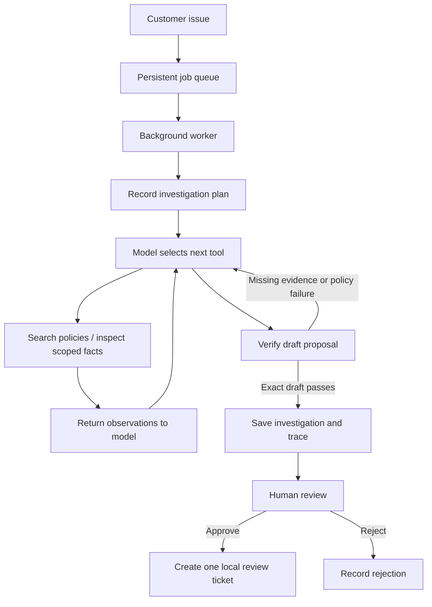

# Relay — Agentic Support Operations

[](https://github.com/Ninjax26/relay-support-agent/actions/workflows/ci.yml)

An evidence-driven support investigation agent built with **Python, Gemini/OpenAI tool calling, BM25 retrieval, and SQLite**. Relay plans an investigation, chooses scoped tools, checks its draft against evidence requirements, and proposes a review ticket for human approval.

Example: a customer reports a duplicate charge. Relay retrieves the billing policy, inspects the payment ledger, drafts a cited answer, verifies its proposal, and waits for approval. Approval creates one local review ticket; it does not issue a refund.

## Features

- Model-selected tools with a **plan → observe → revise → verify → review** loop.
- Gemini and OpenAI adapters; Gemini is the live launcher's default.
- BM25 knowledge retrieval and inspectable evidence citations.
- Server-scoped account lookup and service-status tools using fictional fixtures.
- Verification bound to the exact proposal; new evidence or plan changes invalidate it.
- Transactional, idempotent approval and rejection in SQLite.
- Charcoal and burnt-orange UI with saved runs, plans, evidence, traces, and JSON export.
- Persistent background queue, configurable workers, per-step checkpoints, duplicate-submission protection, and explicit retry.
- Paginated history, browser progress polling, reload recovery, and local queue health metrics.
- Scripted demo mode, provider contract tests, evaluation CLI, and GitHub Actions.
- Bounded transient-error retries and distinct connection, authentication, and quota errors.

## Quick start

Requires **Python 3.10+**. Demo mode uses the standard library only: no dependency installation or API key required.

```sh
git clone https://github.com/Ninjax26/relay-support-agent.git
cd relay-support-agent
python3 server.py
```

Open **http://127.0.0.1:8000**, pick a scenario, and select **Investigate issue**. Inspect the sources and trace before approving or rejecting.

| Scenario | Investigation |
| --- | --- |
| Duplicate charge | Billing policy and settled payments for the same invoice |
| API timeouts | Incident status, affected region, and response playbook |
| Locked account | Account lock state and identity-review policy |
| Failed export | Plan eligibility and export service status |
| Unknown issue | Missing information and human support escalation |

## Live AI mode

### Gemini

Create a key in [Google AI Studio](https://aistudio.google.com/apikey), then run:

```sh
PORT=8001 python3 run_live.py
```

Enter the key at the **hidden terminal prompt**. Open **http://127.0.0.1:8001** and select **Live LLM**. The key stays in the process environment and is not written to disk. Never put credentials in issues or source files.

The default model is `gemini-3.8-flash`; override it with `GEMINI_MODEL`. Eligibility and quota depend on your account; check [Google's current pricing](https://ai.google.dev/gemini-api/docs/pricing). Live requests send issue text and tool observations to Google. Use fictional data, particularly when testing the free tier.

For a small authenticated tool-call connection check:

```sh
python3 run_live.py --check
```

### OpenAI

```sh
PORT=8001 python3 run_live.py --provider openai
```

Enter the OpenAI key privately. `OPENAI_MODEL` overrides the default `gpt-4.1-mini`. Provider pricing and quota apply.

### Configuration

| Variable | Purpose |
| --- | --- |
| `AGENT_PROVIDER` | `gemini` or `openai`; set by the launcher from `--provider` |
| `GEMINI_API_KEY` / `OPENAI_API_KEY` | Alternative to the hidden prompt |
| `GEMINI_MODEL` / `OPENAI_MODEL` | Model override |
| `GEMINI_TIMEOUT_SECONDS` | Request timeout, 5–60 seconds; default 60 |
| `PORT` | Local HTTP port; default 8000 |
| `RELAY_WORKERS` | Worker threads per process, 1–16; default 2 |
| `RELAY_QUEUE_CAPACITY` | Queued plus running jobs, 1–5000; default 100 |
| `RELAY_DB_PATH` | Optional separate SQLite workspace path |

`.env.example` contains empty key placeholders and **is not automatically loaded**. A separate evaluation terminal needs its own environment credentials.

## Architecture and workflow



The model chooses tools based on observations. Python validates and executes requests. The model cannot select another customer account or invoke arbitrary shell, SQL, payment, or account-write tools.

`verify_case` checks retrieved citations, action-specific evidence coverage, known invoice/incident identifiers, and limited prohibited action claims. Failed checks return to the model. `complete_case` accepts only the exact verified draft after the latest evidence or plan change.

The loop permits **16 tool calls**, checks a **180-second** wall-clock budget between calls, and uses configurable workers (**two by default**) behind a persistent queue. The wall-clock check is not a hard cancellation deadline for an in-flight provider request. Transient Gemini HTTP 500/502/503/504 errors receive up to three total attempts with bounded backoff. Retries do not replay local tool actions.

## Tests and evaluation

```sh
python3 -m unittest discover -s tests -v
python3 evals.py
python3 scripts/check_publish.py
python3 scripts/benchmark_jobs.py --jobs 50 --workers 4
```

Tests cover routing, input validation, tool boundaries, verification feedback and invalidation, provider metadata replay, connection failures, and approval transactions. The demo evaluator includes **10 cases**, checking routing, required citations, verification, and absence of unapproved tickets.

With provider credentials configured in the evaluation process:

```sh
python3 evals.py --live --limit 1
```

Live evaluation consumes quota. These checks **do not measure full semantic answer accuracy** or establish prompt-injection resistance.

## Agent quality evaluation

A separate quality suite contains 70 synthetic cases with fixed development and test splits. It reports action/tool checks, evidence coverage, clarification and abstention text proxies, latency, and returned tokens. Companion CSV files support human review of groundedness and response usefulness.

```sh
python3 evals.py --validate
python3 evals.py --suite quality --split dev --output reports/demo-dev.json
python3 evals.py --suite quality --live --provider gemini --prompt-key --split test --output reports/live-test.json
```

Use development cases for tuning and reserve test cases for a frozen configuration. Automatic scores are not semantic answer accuracy. Generated reports remain local in the ignored reports directory. See [evaluation reference](docs/EVALUATION.md).

## Project structure

```text
supportops/       Agent loop, providers, tools, SQLite persistence
web/             HTML, CSS, JavaScript workspace
data/            Fictional policies, accounts, service status
tests/           Unit and mocked-provider tests
scripts/         Publication checks
docs/            Execution workflow, setup, operations, and API reference
server.py        Local HTTP API and static server
run_live.py      Hidden key prompt and connection check
evals.py         Demo/live evaluation CLI
```

## HTTP API

| Method | Endpoint | Purpose |
| --- | --- | --- |
| GET | `/api/config` | Provider availability and fixture accounts; no credentials |
| GET | `/api/runs?limit=20&before=<id>` | Paginated summaries and next cursor |
| GET | `/api/health` | Worker configuration, queue counts, and local ticket count |
| GET | `/api/runs/{id}` | Saved investigation, evidence, plan, trace |
| POST | `/api/runs` | Queue an investigation; returns 202. Include a unique `request_id` for duplicate protection |
| POST | `/api/runs/{id}/retry` | Start a new linked run for a failed/interrupted investigation |
| POST | `/api/runs/{id}/decision` | Submit `{ "decision": "approve" }` or `reject` |

## Scope and limitations

- **Demo mode is scripted.** Only live mode uses LLM-selected tools.
- Accounts, payments, incidents, and knowledge documents are **fictional fixtures**.
- Approval creates a **local ticket**, not an external ticket or actual refund.
- Retrieval is **lexical BM25**, not embedding/vector search.
- Verification is **mechanical**, not proof that every claim is supported.
- Each completed step is saved. Interrupted model conversations are not resumed; an explicit retry starts a new linked run.
- The server binds to loopback. Authentication and tenant authorization are not implemented; internet deployment requires a production server and access controls.

Credentials, runtime databases, local screenshots, caches, and private configuration are excluded from publication. A tracked-file allowlist and credential-pattern scan run in CI. Pattern scanning is defense in depth, not a guarantee of detecting every possible secret.

## Documentation

- [Execution workflow](docs/WORKFLOW.md)
- [Provider configuration and troubleshooting](docs/EXTERNAL_SETUP.md)
- [Job processing, recovery, and API reference](docs/SCALING.md)
